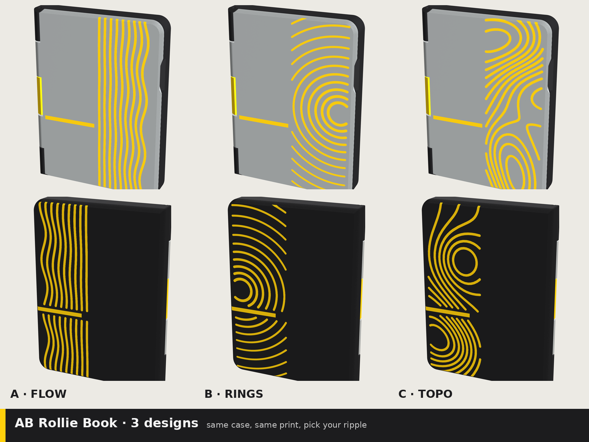
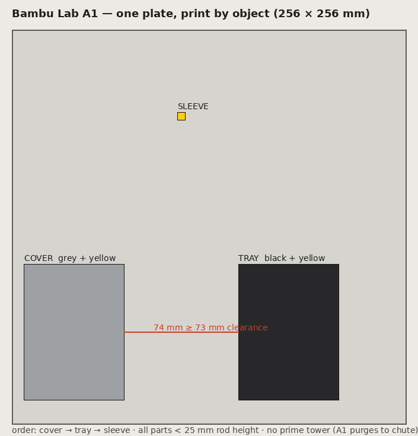

# AB Rollie Book v7.1: 65 × 13.5 × 88 mm, Bambu Lab A1 (current)

v7.1 is the first-print revision: it applies the feedback from the v7.0 test print (23 Nov 2026). It comes in **three ripple designs**. Everything else is identical: geometry, magnets, hinge, settings and print time.

| File | Ripple design |
|---|---|
| **`AB_Rollie_Book_v7_A1_by_object_A_Flow.3mf`** | **A · Flow:** Design 6 ripples, now unbroken on the front, edge to edge |
| **`AB_Rollie_Book_v7_A1_by_object_B_Rings.3mf`** | **B · Rings:** a stone dropped at the clasp; rings spread and thin out, front and back |
| **`AB_Rollie_Book_v7_A1_by_object_C_Topo.3mf`** | **C · Topo:** contour lines, a nod to the v1 Topo Edition |
| `AB_Rollie_Book_v7_A1_geometry_only_<design>.3mf` | **Fallback** if a main file ever refuses to open: same parts, colours and plate, but your own A1 presets. **It has no automatic magnet pauses**, so pause by hand (see below). |

Each main file is a complete Bambu Studio project: A1 + AMS lite, one plate, print **by object**. `stl/<design>/` holds the loose STLs. The v7.0 files you printed are in `superseded/v7.0-first-print/`.

## What changed from v7.0 (your first-print feedback)
| Feedback | v7.1 |
|---|---|
| Magnets didn't fit; they measure 9.53 × 2.53 | Pockets are now **Ø9.85** drop-in (they print at about 9.7), **sealed inside** the cover and tray during the print under **≈ 1.0 mm (6 layers)**. No snap lip. |
| Tray magnet holder was square | Now a **round column**, matching the grey cover's round boss. The Ø11.85 circle on top is the socket the grey boss sits in; the magnet is sealed **below** it ([cut-through](magnet_section_v7.1.png)). |
| "Stop by itself and give me a signal" | The printer **chimes and pauses itself** at the right layer of each part. Drop the magnet in, press Resume. |
| Panels too thick | Cover and back are **2.0 mm** (were 3.0 / 2.6) with **100% infill**. The case is **13.5 mm** deep (was 15). Rollie space is unchanged. |
| "Squares" on the surfaces | They were the outlines of the 100%-infill blocks and the octagon frame. Both are gone. Top surfaces now print **concentric**. |
| Sharp edges | Long edges are **rounded** (R3, with a 45° run-out at the bed so they print cleanly). Corners are R6 on the opening side and R1 on the spine. The lip is rounded and the thumb notch is a smooth arc. The 3 grip notches that printed as lumps are removed. |
| Warped on one side | **4 mm brim**; parts are now **114 mm** apart. Clean the plate with dish soap, and dry the filament (see below). |
| Yellow line thicker | Datum lines are **2.0 mm** wide (were 1.0). |
| Yellow in the ripple slits; ripples connected; reach the edges | Ripples are **filled flush with yellow** on the cover **and** tray back. They run top edge to bottom edge, in 3 designs. |

## The only extra parts you need
| Part | Qty | Notes |
|---|---|---|
| Round magnets **Ø9.53 × 2.53 mm** | 2 | Dropped in during the print (the printer stops for them) |
| **1.75 mm filament** (PETG) | ≈ 87 mm | Hinge pin |
| PETG **grey / black / yellow** | AMS lite slots 1 / 2 / 3 | Cover / tray / yellow details and spine sleeve |

## How to print
1. **Dry the filament first:** 65 °C for 4–6 h. Damp PETG causes the blobs, zits and strings seen on the first print, and makes warping worse.
2. Open the 3MF for the design you want. If Bambu Studio asks about **customised presets**, keep the project's settings.
3. **Don't press Sync AMS.** Your spools (Elegoo Rapid PETG yellow, generic PETG black) have no Bambu RFID tag, so Sync would swap in each slot's preset. Instead, in the **Print** dialog, map Filament 1 / 2 / 3 to your **grey / black / yellow** slots. This keeps the project's profile: 240 °C, plate 70 °C, black capped at 15 mm³/s.
4. Check the plate shows **By object** and **Textured PEI**. Slice and print.
5. **Magnets:** before printing, stick the two magnets together and mark both touching faces. The printer stops twice, with a short chime each time:
   - **Pause 1, cover** (screen ≈ **layer 25**): drop a magnet into the round pocket, **marked face UP**, press it flat, then **Resume**.
   - **Pause 2, tray** (screen ≈ **layer 82**): same again, **marked face UP**, then **Resume**.
   - The next layers seal the magnets in. With both marked faces up, they attract when the case closes.
   - **If a pause doesn't happen:** pause by hand when the screen reaches layer 25 or 82, as soon as that layer number appears. The pocket is still open at that point.
6. **Hinge:** slide the yellow sleeve between the cover knuckles, then push the filament pin through from the top and trim it flush. Optionally, heat the ends briefly to flare them.

## Print profile (in the main files)
- **Base:** Bambu's **0.16mm High Quality @BBL A1**, filament **Bambu PETG HF @BBL A1** ×3. Your spools (Elegoo Rapid PETG, generic PETG rated 240–260 °C) sit in its 240 °C window. Don't use "Generic PETG HF": it runs at 220 °C, below the black spool's 230 °C minimum.
- **Overrides:** 4 walls (arachne), 6 top / 5 bottom shells, **100% infill**, **concentric top surfaces**, seam at the back, elephant foot 0.15, **outer brim 4 mm**, no supports, no prime tower, flush into infill.
- **Black:** max volumetric speed capped at **15 mm³/s**; its label rates it to 200 mm/s.
- **Magnet pauses:** a short block appended to the A1's layer-change G-code. It plays the first notes of the A1 start-up tune, then sends `M400 U1`, the same command as Bambu's own "Pause". It fires only on the first object (cover) at z 4.04 and the second (tray) at z 7.56. By object, Bambu prints the parts in object-list order; this was checked in Bambu Studio 2.03, 2.08 and 2.09 source. Bambu's own per-layer pauses are ignored when printing by object, which is why the block is needed.

## Test slice and re-slice (PrusaSlicer 2.7.2 set up to match the A1, by object)
| Design | Slice from CAD | **Re-slice of the shipped 3MF** | Filament in parts (grey / black / yellow) |
|---|---|---|---|
| A · Flow | 2 h 38 m 39 s | **2 h 38 m 34 s** | 13.9 / 33.1 / 2.1 g |
| B · Rings | 2 h 38 m 33 s | **2 h 38 m 28 s** | 14.1 / 33.4 / 1.6 g |
| C · Topo | 2 h 40 m 58 s | **2 h 40 m 54 s** | 14.0 / 33.2 / 2.0 g |

- **All three:** 47 colour swaps, 121 layers, **exactly 2 magnet pauses**, on the cover at z 4.04 (screen layer 25) and the tray at z 7.56 (screen layer 82).
- **Real-world time:** add the A1 purge (≈ 15–30 s per swap) and your two pauses, giving **≈ 2¾–3 h**, down from about 4 h. Purge adds ≈ 15–20 g to the chute.
- **Slicer warning "floating bridge anchors" (cover):** benign. It is the 6-layer roof over the cover magnet pocket, which the slicer sees as a bridge over air. In the real print the magnet sits 0.19 mm under it. With the pocket filled in, the warning disappears.

## Verification (all three designs)
| Check | Status |
|---|---|
| Envelope 65 × 13.5 × 88; single solid parts; no overlaps | PASS |
| 6 rollies clear; cover swings to 165° without contact | PASS |
| Magnet pockets empty and sealed by ≥ 0.3 mm of plastic all round; walls ≥ 0.8 mm; 1.16 mm grey under the cover magnet | PASS |
| Pockets open up to the layer before each pause, closed from the pause layer on (exported meshes sliced layer by layer) | PASS |
| Yellow stripes: ≥ 0.6 mm of grey between stripes, stripes ≥ 0.95 mm wide, 4 layers deep (0.68 mm) | PASS |
| Settings vs Bambu's option rules at **2.03, 2.08 and 2.09** | PASS: identical to the baseline (the same 26 legacy flags as the file that opened fine) |
| 3MF integrity: 9 meshes, part filaments 1/2/3, 1 plate by object | PASS (read back from the shipped files) |
| Re-slice of the shipped files | PASS (see above) |
| Independent re-check of each shipped file (`src/recheck_3mf.py`): zip/XML/JSON, key set = v7.0, print order, clearances, pause block, pockets open up to each pause and sealed after, magnet fit, exactly 2 G-code pauses on the right parts | **ALL PASS ×3** |
| Opened in real Bambu Studio | v7.0 PASS (22 Nov). **v7.1 not yet**: please open one and check the preview shows the 2 pauses |
| Test print | v7.0 printed 23 Nov (cover only); v7.1 pending |

**Magnet cover: about 1.0 mm (6 layers) over each magnet, as you chose.** The magnets sit **2.60 mm apart** when closed: an estimated ≈ 400 g of pull for N35 magnets (real magnets are often about 30% less). That's a clear, firm snap. See the cut-through: `magnet_section_v7.1.png`.

`src/` holds the generators. Set `RIPPLE=flow|rings|topo` before running `v7_a1_export.py` to build each design. The v7.0 file and its renders are in `superseded/v7.0-first-print/`.
