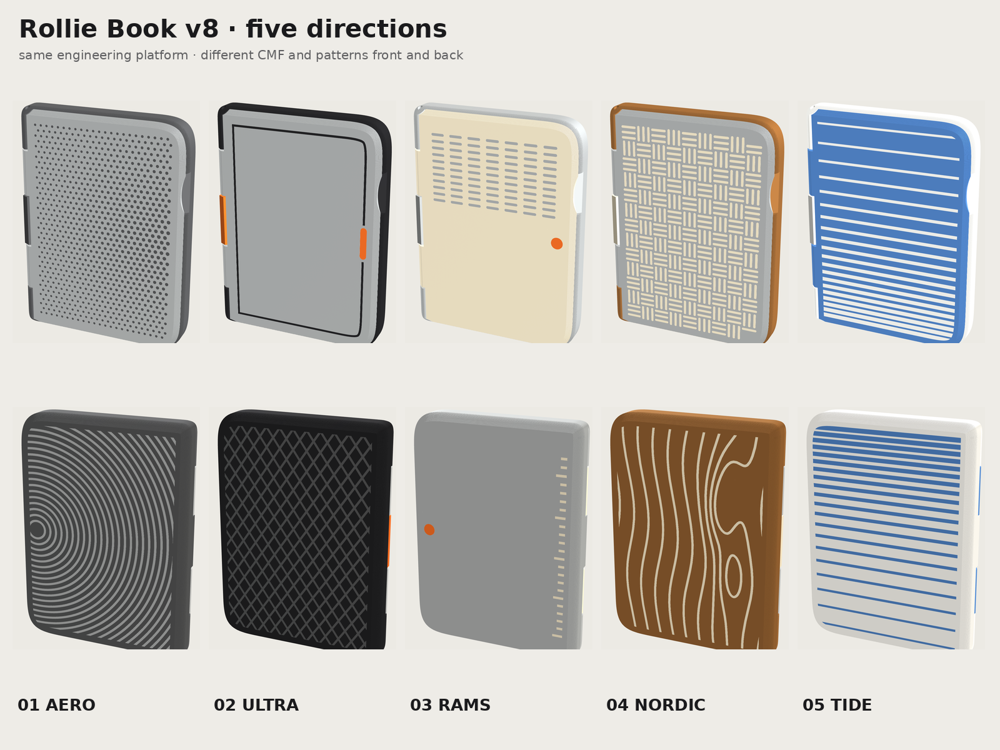

# Rollie Book v8: five premium directions (concepts: renders only, no 3MF yet)

All five sit on the **same engineering platform** (v7.1, proven checks) and differ only in colour, material, finish (CMF) and pattern. Each concept's **front and back carry different patterns.** Each one passed the full `v7.checks()` suite in concept form:
- 65 × 13.5 × 88 envelope;
- single solid parts with no overlaps;
- both magnet pockets empty and sealed;
- 6 rollies clear;
- cover swings with no contact;
- magnets 2.60 mm apart.

## What the research says (and what was taken from it)
- **Bang & Olufsen:** aluminium is the signature material, since 1955. Colour is anodised *into* the metal, not painted on. Grilles are precise fields of circular perforations, and the counts mean something: 1,925 holes on the Beosound Premiere for the founding year. Natural aluminium is paired with **light oak and woven paper**, as in the Beosound A5 Nordic Weave.
  → **AERO** (graded perforation field) and **NORDIC** (aluminium + weave + oak).
- **Apple:** corners are **continuous-curvature superellipses**, not circular arcs. The curve eases out of the straight edge, so there is no visible "join". Apple colourways are monochrome with **one precise accent**; the Apple Watch Ultra is titanium with a single international-orange control.
  → Every concept now has **superellipse (n = 4) plan corners**. **ULTRA** (one orange control, exactly where the thumb opens it). **TIDE** (one bold colour + white, as on the iMac).
- **Dieter Rams / Braun:** mostly achromatic (greys, whites, black). **Colour is used only as a functional signal**: orange marked the FM band on the Braun regie 500, and the scale digits matched it.
  → **RAMS** (cream and grey; the only orange marks the magnet and the opening point).

## Platform changes (all five)
| | v7.1 | **v8** |
|---|---|---|
| Plan corners | Circular, R6 / R1 | **Continuous-curvature superellipse**, opening side ≈ R11 and spine ≈ R4 (Apple-style) |
| Long edges | R3 + 45° bed run-out | **R4.5 + 45° bed run-out**: softer in the hand, still support-free |
| Patterns | Same family front and back | **Different patterns front and back** |
| Colour | Grey / black / yellow | **2–4 Bambu PETG HF colours per concept**; colour has a job |
| Outside colour depth | 4 layers | 4 layers, so no extra colour-swap layers |
| Kept | Sealed magnets with auto-pause, round magnet column, ≈ 1 mm over the magnets, filament hinge, 6 channels + tip bays | Same |

## The five
| # | Name | Reference | Cover / tray | Front | Back | Filaments |
|---|---|---|---|---|---|---|
| 01 | **AERO** | B&O Beosound, anodised aluminium | Gray / Dark Gray | Graded micro-perforation field: Ø1.45 at the clasp easing to Ø0.9 | Fine concentric rings from the clasp, tone-on-tone | **2**: Gray, Dark Gray |
| 02 | **ULTRA** | Apple Watch Ultra | Gray / Black, orange sleeve | One continuous-curvature line 2 mm inside the edge + an orange "action" pill where the thumb opens it | Precision diamond lattice, dark grey on black | **4**: Gray, Black, Orange, Dark Gray |
| 03 | **RAMS** | Dieter Rams / Braun | Cream / Gray | Braun slot grille on the upper half + one orange dot over the magnet ("open here") | Scale ticks along the opening edge + the matching orange dot | **3**: Cream, Gray, Orange |
| 04 | **NORDIC** | B&O Beosound A5 Nordic Weave | Gray / Peanut Brown, cream sleeve | Basket-weave field in cream (the woven paper) | Oak grain bending round two knots, cream on brown | **3**: Gray, Peanut Brown, Cream |
| 05 | **TIDE** | Apple iMac colourways | Lake Blue / White | White lines that thin and spread upward | The same fade in lake blue, running downward | **2**: Lake Blue, White |

**Filament:** apart from Gray / Dark Gray / Black, most concepts need new Bambu PETG HF spools: Cream, Peanut Brown, Orange, Lake Blue, White. The AMS lite takes up to 4, so every concept fits.

**Print-quality notes:**
- The smallest features are AERO's 0.9 mm dots and the 0.8–0.9 mm lines in ULTRA, NORDIC and TIDE. They print, but they are at the fine end for a 0.4 mm nozzle on the first layer.
- A clean, level plate matters most for AERO.
- TIDE puts white next to blue on the first layer; any smear shows. If it does, a slightly larger z-offset or a 0.25 mm first layer helps.

## Further functional ideas (not in the renders; add on request)
- **Pinch scoops:** small finger recesses at the top of the channels, so a rollie can be pinched out with two fingers instead of tipping the case.
- **Single crescent thumb scoop** running across both halves of the opening edge, so the open point is felt rather than looked for.

## Recommendation
- **AERO** is the most "B&O": two colours, nothing shouts, and the perforation field and rings carry the clasp idea front to back. It is also the cheapest to run (2 filaments, fewest swaps).
- **ULTRA** is the most "Apple", with the strongest functional story: the orange marks where you open it.
- Pick one or two, and say if the initials stay. I'll then build the 3MF(s) and rerun all the checks.

## Sources
- [B&O: Beosound A5 Spaced Aluminium](https://www.bang-olufsen.com/en/ca/story/beosound-a5-spaced-aluminium)
- [B&O: Beosound A1 Dune (Cecilie Manz)](https://www.bang-olufsen.com/en/za/story/cecilie-manz-beosound-a1-dune)
- [B&O: craft stories, anodising](https://www.bang-olufsen.com/en/au/story/craft-stories-britta)
- [Gear Patrol: Beosound Premiere](https://www.gearpatrol.com/?p=938936)
- [99% Invisible: squircles](https://99percentinvisible.org/article/circling-square-designing-squircles-instead-rounded-rectangles/)
- [John D. Cook: Apple design and curvature](https://www.johndcook.com/blog/2018/02/13)
- [Apple rounded-corner formula](https://arun.is/blog/apple-rounded-corners)
- [Design Museum: Dieter Rams](https://designmuseum.org/designers/dieter-rams)
- [Braun: the 10 principles through the LE range](https://www.braun-audio.com/en-FR/stories/design/exploring-10-principles-le-range/)
- [SimplyPrint: Bambu PETG HF colours](https://simplyprint.io/filaments/bambu-lab/petg-hf)
- [3DJake: Bambu PETG HF](https://3djake.uk/bambu-lab/petg-hf)

The board images in this folder come from `src/v8_concepts.py` (geometry, patterns, checks) and `src/render/v8_board.py`.
