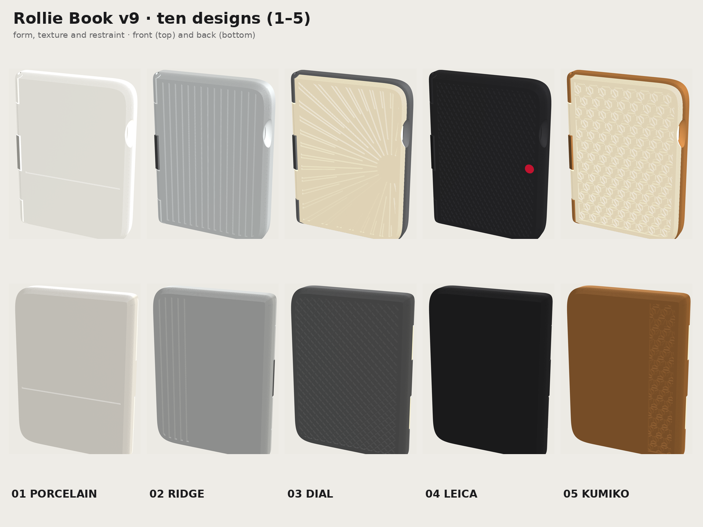
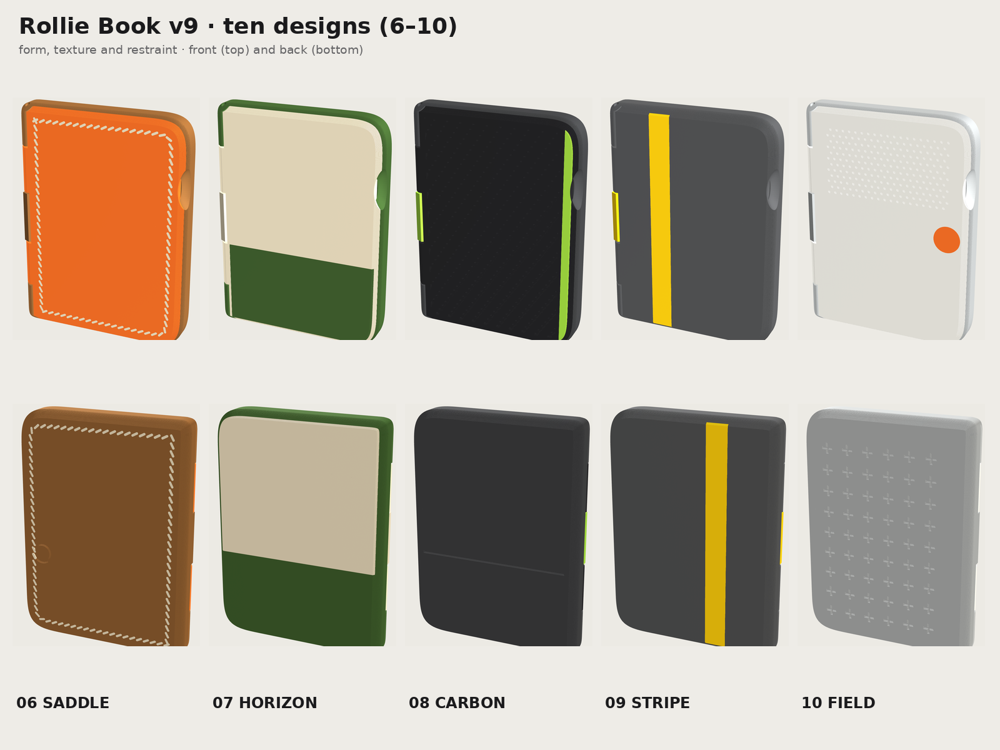

# Rollie Book v9: ten designs (renders only, no 3MF yet)

## Why the visuals changed
- **The problem with v8:** the visuals were *graphics printed onto* a shape. The research points the other way. The most recognisable premium objects get their identity from **form, texture and restraint**, not decoration:
  - **Rimowa** has carried the same grooves since 1950, inspired by the first all-metal aircraft. The texture *is* the brand.
  - **Swiss watch dials** use guilloché: engraved sunbursts and *clous de Paris* (crossing lines forming tiny pyramids that throw shadows).
  - **The Leica M** is a black body, a diamond-pattern leatherette and one red dot. Its design has barely changed since 1954.
  - **Kumiko joinery** builds patterns such as *asanoha* (hemp leaf), each with a meaning (growth, strength).
  - **Teenage Engineering** works in greys and whites with one orange accent.
- **Pantone's 2026 colour of the year** is a white, *Cloud Dancer*, the first white ever chosen.
- **So v9 leans on three tools instead of ink:**
  - **Tone-on-tone engraving:** 3 stepped layers at 45°, so it prints support-free face-down. You *feel* it, and light rakes across it.
  - **Colour blocking:** large, deliberate areas of colour, not lines.
  - **One precise accent:** a single dot, stripe or line that marks something real, usually where the case opens.

## Shared platform (all ten)
- **Shape:** continuous-curvature (superellipse) corners and R4.5 edges, from v8.
- **New: crescent thumb scoop.** One elliptical dish across *both* halves on the opening edge, above the magnet. You find the seam by feel, and the thumb pushes the cover open. It replaces the old cover notch and tray scoop.
- **New: pinch zone.** The channel ribs now stop at 55 mm, so the top ~14 mm of every rollie is free on both sides. A shallow 0.6 mm dish in the floor under each rollie end lets a fingertip get beneath it.
- **Kept:** sealed magnets with auto-pause (≈ 1 mm of plastic over each, 2.6 mm apart), round magnet column, filament hinge, 6 channels + tip bays, 65 × 13.5 × 88.
- **Checks:** every design passes the full engineering check suite (single solid parts, no overlaps, pockets empty and sealed, rollies clear, cover swings freely).

## The ten
| # | Name | Reference | Colours (Bambu PETG HF) | Front | Back |
|---|---|---|---|---|---|
| 01 | **PORCELAIN** | AirPods calm, Pantone 2026 *Cloud Dancer* | White only (**1 filament, zero colour swaps**) | One engraved hairline at the golden section | The same hairline, so it circles the object |
| 02 | **RIDGE** | Rimowa grooves | Gray + Dark Gray sleeve | Full-face engraved grooves | Five grooves along the opening edge |
| 03 | **DIAL** | Guilloché watch dials | Cream / Dark Gray | Engraved sunburst from the clasp | Engraved clous de Paris |
| 04 | **LEICA** | Leica M | Black + one Red dot | Engraved diamond leatherette + red dot over the magnet | Smooth plain black |
| 05 | **KUMIKO** | Japanese asanoha joinery | Cream / Peanut Brown | Engraved asanoha lattice | Narrow asanoha band at the opening edge |
| 06 | **SADDLE** | Hermès-style leather goods | Orange / Peanut Brown, Cream stitch | Saddle stitch around the face | Stitch + blind-stamped ring |
| 07 | **HORIZON** | Mid-century colour blocking | Cream / Forest Green | Cream over green, split at the golden section | Same split, so the green band wraps round |
| 08 | **CARBON** | Motorsport carbon twill | Black / Dark Gray + Lime | Engraved 2/2 twill + lime line where the thumb goes | Plain, one engraved hairline |
| 09 | **STRIPE** | Racing livery, Porsche Design restraint | Dark Gray + **Yellow** (your spool) | One 8 mm stripe, end to end | Same stripe, in line |
| 10 | **FIELD** | Teenage Engineering | White / Gray + Orange | Engraved dot grille + orange "knob" over the magnet | Fine engraved plus-grid |

The initials are engraved (tone-on-tone) on 01, 02, 03, 05 and 08, and inlaid in the accent colour on the others.

## Engraving and print notes
- **How it's cut:** the engraving is 0.52 mm deep in three 45° steps. The narrowest groove at the surface is about 0.85 mm, so it prints cleanly face-down without supports.
- **Plate texture:** on the textured PEI, the raised areas get the plate texture and the engraved lines stay crisp. A **smooth PEI plate** would make the engraving read even more like machined metal (worth trying on DIAL and RIDGE).
- **Filament:** most designs need new Bambu PETG HF colours. The cheapest to start with are **PORCELAIN** (white only), **RIDGE** (Gray + Dark Gray) and **STRIPE** (Dark Gray + the yellow you have).

## Sources
- [Rimowa heritage](https://www.rimowa.com/gb/en/heritage)
- [Monochrome Watches: the art of guilloché](https://monochrome-watches.com/technical-perspective-the-art-of-guilloche-dials-examples-of-guilloche-patterns-comparison-stamped-cnc-dials)
- [Clous de Paris explained](https://luxe.outlookindia.com/amp/story/watches-jewellery/watches/clous-de-paris-explained-origins-craftsmanship-and-why-it-matters-in-fine-watchmaking)
- [Red Dot: the Leica camera](https://www.red-dot.org/zh/magazine/a-distinctive-product-design-the-leica-camera)
- [Leica metal grey](https://leica-camera.com/en-GB/photography/products-metal-grey)
- [Leica and Bauhaus simplicity](https://lavidaleica.com/content/leica-and-bauhausian-simplicity-design)
- [Kumiko (woodworking)](https://en.wikipedia.org/wiki/Kumiko_(woodworking))
- [Tanihata asanoha](https://www.tanihata.co.jp/english/products/tn-101/)
- [Wallpaper: OP-1 Field](https://www.wallpaper.com/technology/teenage-engineering-op-1-field-review)
- [Wallpaper: TE Field black](https://www.wallpaper.com/tech/teenage-engineering-field-system-black-series)
- [Pantone 2026 Cloud Dancer](https://www.pantone.com/uk/en/articles/press-releases/pantone-announces-color-of-the-year-2026-cloud-dancer)
- [Dezeen: Cloud Dancer](https://www.dezeen.com/2025/12/04/lofty-white-cloud-dancer-pantone-colour-of-the-year-2026/)

These boards come from `src/v9_concepts.py` (geometry, engraving, checks), `src/render/shot9.js` (views) and `src/render/v9_board.py`.
