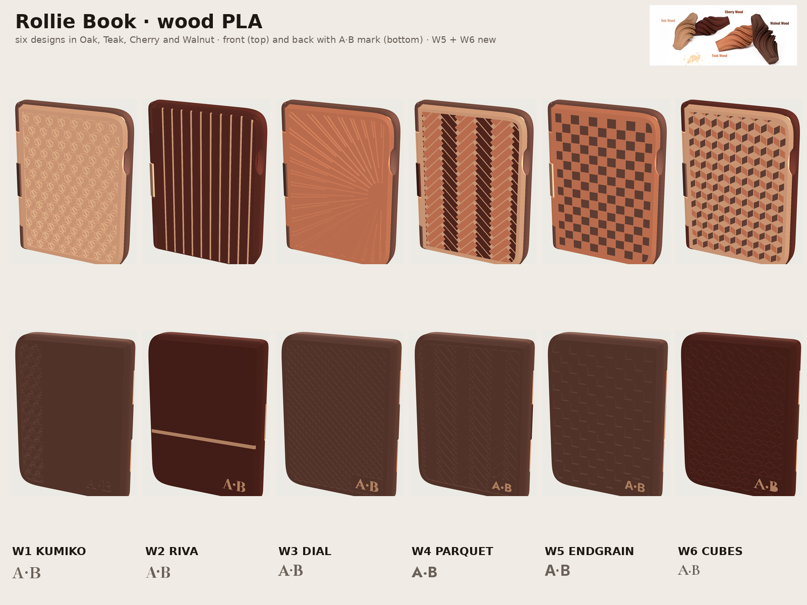

# Rollie Book · wood PLA: six designs

Six designs in the four wood PLA tones from your photo: **Oak, Teak, Cherry, Walnut**. Four tones means all four AMS lite slots.
- Each design takes its cue from a wood craft or brand.
- Its **A·B** uses a typeface from the same world, placed as a **maker's mark in the bottom corner of the back plate**, on the hinge side.
- **Every design also comes without initials.**

**Status (24 Nov):**
- **W1–W4 are approved and built.** Their print files are in [`../wood-3mf/`](../wood-3mf/README.md).
- **W5 ENDGRAIN and W6 CUBES are new.** They replace TAMBOUR and INLAY and need your approval. Once you approve, their 3MFs come from the same exporter in minutes.

| # | Design | Inspired by | Woods | A·B typeface |
|---|---|---|---|---|
| W1 | **KUMIKO** | Japanese kumiko joinery (asanoha lattice) | Oak lid, Walnut base | Shippori Mincho (Japanese foundry serif), engraved |
| W2 | **RIVA** | Riva Aquarama mahogany decks with pale seams | Cherry, Oak seams | Bodoni (Italian), inlaid Oak |
| W3 | **DIAL** | Swiss watch dials: sunburst and clous de Paris | Teak lid, Walnut base | Cinzel (Roman capitals, as on casebacks), inlaid Oak |
| W4 | **PARQUET** | European herringbone parquet (marquetry) | Teak + Cherry staves laid in an Oak lid (oak shows as the joints), Walnut base: **all four woods** | Jost (Futura-like), inlaid Oak |
| W5 | **ENDGRAIN** · new | End-grain butcher blocks; the quiet two-tone check of old travel trunks | Teak lid with Walnut blocks, Walnut base with the chequer engraved tone-on-tone, Oak hinge | Inter (Helvetica-like), inlaid Oak |
| W6 | **CUBES** · new | 18th-century French marquetry *à cubes* (tumbling blocks) | Oak / Teak / Walnut cubes on the lid (a 3D illusion), Cherry base with the cube outlines engraved: **all four woods** | Garamond (the French ébénistes' typeface), inlaid Oak |

**Why these two:** you kept the four all-over patterns and dropped the two quiet ones (stringing and flutes), so both replacements are all-over marquetry.
- **ENDGRAIN** is the calm one: two browns, one fine chequer.
- **CUBES** is the showpiece: three woods make each block look solid.

**Initials placement:**
- The mark sits on the back plate, which prints face-down. It therefore uses the same first 4 layers as the other inlays.
- That removes the dozens of colour changes the old upright bottom-end lettering caused.
- The back pattern is cleared round the mark, so it sits in a clean field.

**Font sizing:** the serif fonts are set at 6 mm cap height with their vertical strokes thickened slightly (0.10–0.12 mm), so the hairlines survive a 0.4 mm nozzle.

## New inside (all six): your 24 Nov feedback
| | Before (v7.1) | **Now** |
|---|---|---|
| End walls | 9 mm solid blocks | **2 mm** (24 Nov). Channels go from 70 to ~84 mm long, so standard 70 mm papers fit, not just 60 mm rollies. |
| Infill | 100% everywhere | **Light: about 15% gyroid** (set when the 3MF is built). With thin walls, most of the case is solid perimeters anyway. |
| Inside edges | Sharp | **All rounded:** • cavity corners R2.5 • floor fillet R1.2 • rim round-over R0.5 • rib tops and ends fully rounded (capsule ribs) • lip fully rounded on top • chamfered magnet sockets and bosses |
| Magnets | One Ø9.53 × 2.53 pair, centre of the opening edge | **Two Ø5 × 2 pairs, one at each opening-edge corner.** The case closes evenly at both ends instead of pivoting round one centre magnet. The middle of the opening side becomes **one long filter-tip bay**. |
| Cover over magnets | ≈ 1 mm | **0.8 mm (5 layers) each side**, as asked: the first layers over the metal bond poorly. |
| Closing pull | ≈ 400 g (felt too strong) | **≈ 175 g** (N35 estimate; real magnets often pull less). Inside your 150–200 g target. |
| Thumb and fingers | Crescent scoop + pinch zone | Kept |

**The magnets in practice:**
- **Still one pause per half.** Drop **both** magnets at each pause: cover first, then tray.
- **Polarity** (two magnets at once can't be marked as one pair):
  1. Stack all four magnets in one column.
  2. Mark the **top** face of each.
  3. **Cover:** marked face **up**. **Tray:** marked face **down**.
  
  They then attract when the case closes.

## Wood PLA: what changes when you print it
- **Nozzle:** wood fibres are mildly abrasive and can clog. Bambu advises against stainless or brass nozzles for wood PLA.
  - Use a **hardened-steel nozzle**: 0.4 mm works for many A1 users.
  - If you get clogs, move to **0.6 mm**. The finest detail here (≈ 0.85 mm engraved lines, serif letters) still prints at 0.6, slightly softer.
- **Drying and temperature:** dry the spools first (Bambu suggests 55 °C for 8 h). Bambu lists 190–240 °C; A1 users report good results around 220 °C.
- **Heat warning:** PLA softens at about 55–60 °C. **Don't leave the case in a car or on a sunny dashboard**, which can pass 65 °C. Your PETG versions are much better there.
- **Hinge pin:** use your **PETG filament** for the pin (tougher than PLA).
- **Warping:** PLA warps far less than PETG, so the brim can drop to 3 mm or go entirely.

## Sources
- [Bambu wiki: filament guide material table](https://wiki.bambulab.com/en/general/filament-guide-material-table)
- [Bambu forum: printing wood considerations](https://forum.bambulab.com/t/printing-wood-considerations/2819)
- [Bambu forum: printing PLA wood](https://forum.bambulab.com/t/printing-pla-wood/252240)
- [MatterHackers: Bambu Wood PLA (temps, drying)](https://www.matterhackers.com/store/l/bambu-lab-wood-pla-filament/sk/MGYJ3WDE)
- [JLC3DP: PLA temperature resistance](https://jlc3dp.com/blog/pla-temperature-resistance)
- [QIDI: car-interior heat](https://qidi3d.com/blogs/print-lab/best-filament-car-interiors-abs-asa)
- [Rimowa heritage](https://www.rimowa.com/gb/en/heritage)
- [Monochrome Watches: guilloché](https://monochrome-watches.com/technical-perspective-the-art-of-guilloche-dials-examples-of-guilloche-patterns-comparison-stamped-cnc-dials)
- [Kumiko (woodworking)](https://en.wikipedia.org/wiki/Kumiko_(woodworking))

These boards come from `src/w_concepts.py` (designs, `PLATFORM=v10`), `src/render/shotw.js` and `src/render/w_board.py`. The fonts and their licences are listed in `fonts/README.md`.
