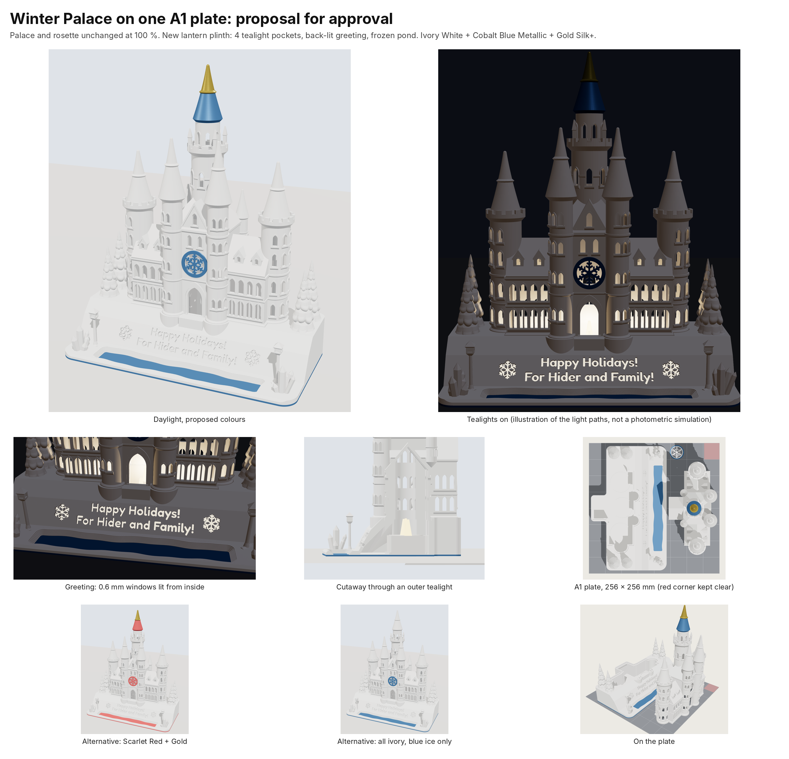

# Winter Palace: one A1 plate, four tealights, lit greeting

**Status (26 Nov 2026): design proposal, awaiting approval from renders. No print file has been built yet.**

A rework of 3D2K's *Winter Palace Diorama for LED Tealights* (MakerWorld) so that it prints in **one go on a Bambu Lab A1** in under 15 hours, takes **37 × 38 mm tealights**, and carries the greeting *"Happy Holidays! For Hider and Family!"* lit from inside.



## What changes, and why

| | Designer's original | This rework |
|---|---|---|
| **Palace** | 183 × 95.3 × 248 mm | **Unchanged**, 100 % scale |
| **Rosette** | 27.8 mm press-fit insert | **Unchanged** |
| **Base** | 243 × 241 mm snow plate, 114 mm tall with trees | **New 244 × 148 mm "lantern plinth"**, 108 mm tall with trees |
| **Plates** | 2 (the base alone fills a 256 mm bed) | **1** |
| **Tealights** | 3, Ø40 pockets for Ø38 lights | **4**, Ø38.4 pockets for Ø37 lights |
| **Greeting** | none | on the front, back-lit by the same tealights |
| **Colours** | all white | ivory, with cobalt and gold accents |

The original base cannot share a 256 mm bed with the palace, and shrinking everything to make it fit (about 74 %) leaves the hall only 32 mm deep, too small for a 37 mm tealight. So the palace stays full size and the base is redesigned around it.

## The new base

- **Plinth, 42 mm tall.** The palace drops into a 3 mm recess on top, exactly as on the original (0.40 mm clearance per side; the designer used 0.35).
- **Light cavity.** Under the palace the plinth is hollow down to a 2.4 mm floor. Tealights stand on that floor, so a 38 mm light ends with its flame tip 1.4 mm above the palace's bottom edge, inside the palace. Taller lights simply reach further in.
- **Four pockets.** Three across the hall on raised locating rings (0.6 mm radial clearance), one under the chapel (0.4 mm). The three hall lights lower straight in; the chapel light goes in first, 2.5 mm forward of its seat, and slides back against the wall.
- **Greeting.** The front is a 60° snow bank, 3 mm thick. The letters (Fredoka SemiBold, 8 mm capitals) and two snowflakes are sunk 2.4 mm into it, leaving **0.6 mm windows** that glow when the tealights are on. Unlit, the text still reads as an engraving.
- **Apron.** A low strip in front with a frozen pond, two lanterns and two ice-crystal clusters.
- **Scenery.** The four fir trees, the lanterns and the crystals are the designer's own, lifted off the original base and replanted.
- **Plan.** T-shaped like the palace (full width at the front, a narrower bay behind the chapel). Together with four trees rather than six, that takes about an hour off the print.

## Colours, from the delivered filament

| AMS lite slot | Filament | Where |
|---|---|---|
| 1 | **PLA Matte Ivory White** (11100) | Palace, base, trees: everything that should glow |
| 2 | **PLA Metal Cobalt Blue Metallic** (13600) | Frozen pond, 1.6 mm trim line round the base, snowflake rosette face, roof of the main spire |
| 3 | **PLA Silk+ Gold** (13405) | Collar and finial of the main spire |

About **10 filament changes in total**: one per layer through the first 8 layers, then one at 194.4 mm (spire) and one at 221.6 mm (finial).

Why not green trees or red roofs: every layer that mixes two colours costs a filament change of roughly 1½ minutes. The trees share about 330 layers with the palace, which would add over 300 changes, roughly 8 extra hours. Colour is therefore placed where it is confined to a few layers (the bottom 1.6 mm) or sits above everything else (the top of the tallest spire).

Alternatives rendered: Scarlet Red in place of the cobalt (`renders/13_…`), and all ivory with only the blue ice (`renders/14_…`). Not used: PETG Translucent Olive (PETG does not bond to PLA in one part).

## Print plan (to be built into the 3MF after approval)

- **Printer and plate:** Bambu Lab A1, 0.4 mm nozzle, Textured PEI. Long sides of both parts run along Y, the axis the bed moves on.
- **Layer height:** 0.20 mm throughout.
- **Walls:** Arachne, 2 loops (fills the palace's 2.2 mm walls solid, as the designer intended).
- **Infill:** 15 % in the palace, 8 % in the base. 5 top layers, 3 bottom layers.
- **Speeds:** palace outer walls slowed to 120 mm/s at 3000 mm/s² for cleaner detail; base at the stock 0.20 mm Standard speeds.
- **Supports:** none. **Prime tower:** off (there is no room for one; the A1 purges into its chute).
- **Brim:** 3 mm outer brim on the palace only. Trim it before seating the palace in the recess.

## Verification

Run with `src/checks.py`; figures below are from the current geometry.

| Check | Result |
|---|---|
| Fits the 256 × 256 mm bed | Yes. Smallest margin to the bed edge 4.0 mm; base-to-palace gap 4.0 mm |
| Height | 248.0 mm (palace), limit 256 mm |
| A1 nozzle wrap-detection corner | Clear |
| Palace against base, assembled | No intersection; flange bears on 2.7 mm of ledge all round |
| Tealights against base and palace | No intersection |
| Support-free | Base: nothing extends more than 2 mm beyond the layer below. The palace's own worst case is a 5 mm window bridge |
| Print time | Model reads **13 h 03 m** as planned (12 h 13 m with the palace at stock speed too). Realistic expectation **about 14 h**, see below |
| Filament | About 365 g printed (roughly 325 g ivory, 40 g cobalt, 1 g gold), plus about 6 g purge |
| Assembled size | 244 × 148 × 287 mm |

**How far to trust the print time.** No slicer could be run in this session, so the time comes from `src/estimate.py`, a toolpath-length model with an acceleration-limited planner. The only reference available is the designer's own Bambu Studio slice, which stores two first-layer times, and the model read both of them short: 1174 s against 1284 s for the base (9 % under) and 293 s against 317 s for the palace, rosette and 5 mm brim (7 % under). Applying that same shortfall to the whole job gives **about 14 h**, and a sensible range is 13 to 15 h. Bambu Studio's own figure after slicing is the one that counts. If it reads over 15 h, put the palace outer wall speed back to 200 mm/s, which saves about 50 minutes.

**What the lit render is.** `03_front_lit` and `04_greeting_lit` place warm point lights at the four flame positions with shadows, so light only escapes through real openings. The glow of the 0.6 mm letter windows is drawn in, not simulated. It shows where the light goes, not how bright it will be.

## Open points before the build

1. **Spelling of the greeting**, exactly as it should be printed.
2. **Colourway**: cobalt and gold as proposed, red and gold, or ivory only.
3. **Real tealights only if they are LED.** PLA softens at about 55 °C; a wax tealight under a closed PLA shell is a fire risk.
4. **Tealight shape.** The pockets assume a 37 mm body up to about 20 mm tall with the flame above it.

## Rebuilding

The designer's 3MF is not in this repository (it is not ours to redistribute). Point `WP_SRC` at your own copy.

```bash
pip install manifold3d shapely trimesh numpy scipy matplotlib pillow fonttools networkx rtree
```
```bash
export WP_SRC=/path/to/Winterpalast_mit_Rosette_eine_Platte.3mf WP_WORK=/tmp/wp_work
```
```bash
python3 src/checks.py all /tmp/wp_work/checks.json
```
```bash
mkdir -p /tmp/wp_r && cp src/render/view.html /tmp/wp_r/ && curl -sSfL -o /tmp/wp_r/three.min.js https://cdnjs.cloudflare.com/ajax/libs/three.js/r128/three.min.js
```
```bash
for w in frost xmas ivory; do python3 src/render/make_scenes.py /tmp/wp_r $w; done
```
```bash
node src/render/shot.js /tmp/wp_r frost_hero_day frost_hero_night frost_front_day frost_front_night frost_greeting_day frost_greeting_night frost_back_day frost_top_day frost_plate_top frost_plate_persp frost_cut_x50 frost_cut_x0 xmas_hero_day ivory_hero_day
```
```bash
python3 src/render/sheet.py /tmp/wp_r renders
```

`shot.js` needs Playwright with Chromium (run it from a directory where `require('playwright')` resolves).

| File | Role |
|---|---|
| `src/build.py` | All geometry: parameters, the new base, greeting, scenery transplant, assembly and plate layout |
| `src/checks.py` | Fit, clearance, support-free and print-time checks |
| `src/estimate.py` | Print-time model |
| `src/common.py` | Reads the three meshes out of the designer's 3MF |
| `src/render/` | Scene export, viewer, screenshots, approval sheet |
| `fonts/` | Fredoka SemiBold (SIL OFL 1.1) |

## Credit and licence

Palace, rosette, trees, lanterns and crystals are by **3D2K** (*Winter Palace Diorama for LED Tealights*, MakerWorld, Standard Digital File License). This rework is for personal use and a gift; the modified model should not be published or shared without the designer's permission.
